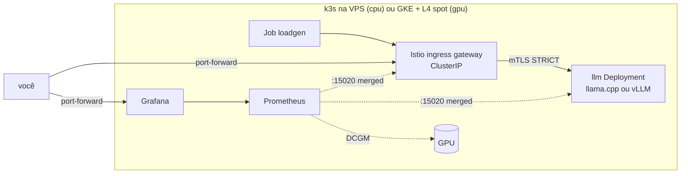

# llm-serving-lab

Servir um modelo open source em Kubernetes com GPU, com **custo e observabilidade
medidos**. Projeto pequeno e feito para terminar: o critério de pronto é um post
no allans.dev com p95, tokens/s e custo por mil requisições reais, e o cluster
desligado.

**Teto:** US$50. **Prazo:** 3 a 4 fins de semana. Passou de 6 semanas, corta a
etapa 5 (docs/decisions.md, D7).

## Escopo

| Entra | Não entra |
|---|---|
| 1 cluster, 1 nó de GPU ligado só nos testes | fine-tuning, RAG |
| 1 modelo pequeno (Qwen2.5-1.5B-Instruct) via vLLM | multi-região |
| Istio como ingress, mTLS STRICT, latência por rota | autoscaling sofisticado |
| Prometheus + Grafana com custo por requisição e por token | front-end |

## Dois perfis, mesmos manifests

A VPS do delfos não tem GPU. Por isso tudo é construído primeiro lá, de graça, e
a GPU só liga para medir (docs/decisions.md, D1).



| | `PROFILE=cpu` | `PROFILE=gpu` |
|---|---|---|
| Cluster | k3s, VPS srv1296923 (4 vCPU, 15 GB) | GKE zonal, e2-standard-4 spot + g2-standard-4 spot (1× L4) |
| Servidor | llama.cpp, GGUF Q4_K_M | vLLM v0.32.0, bf16 |
| Custo/hora | ~US$0,014 (fixo) | ~US$0,35 (só ligado) |
| kubeconfig | `.kube/cpu.yaml` (túnel SSH) | `.kube/gpu.yaml` |

O Makefile **sempre** passa `--kubeconfig` explícito, então nunca usa o contexto
padrão da máquina.

## Etapas

- [ ] **1. GPU visível no pod.** `make gke-up && make PROFILE=gpu gpu-operator gpu-check`
- [ ] **2. Modelo no ar.** `make deploy smoke`
- [ ] **3. Istio na frente.** Gateway, VirtualService, `PeerAuthentication` STRICT, `AuthorizationPolicy` (`make istio`)
- [ ] **4. Métricas.** Latência por rota, req/s, tokens/s, GPU, CPU e memória (`make monitoring`)
- [ ] **5. Custo.** `llm:cost_usd_per_1k_requests` e `llm:cost_usd_per_1m_output_tokens` no dashboard
- [ ] **6. Post.** `docs/post-template.md` preenchido com `results/*.jsonl`
- [ ] **Pronto:** post publicado e `gcloud container clusters list` vazio

## Como rodar

Pré-requisitos locais: `kubectl`, `helm`, `kustomize`, `ansible-playbook`. Para o
perfil GPU: `gcloud` com `gke-gcloud-auth-plugin`.

### Perfil CPU (VPS)

```bash
make vps-check                 # dry-run do playbook (--check --diff)
make vps-up                    # k3s + firewall, salva .kube/cpu.yaml
make vps-tunnel                # em outro terminal: ssh -L 6443
make platform                  # Istio + Prometheus/Grafana + regras + dashboard
make deploy smoke              # baixa o modelo (1 GB) e faz um curl pelo gateway
make load                      # varredura 1,2,4,8 de concorrência → results/cpu-*.jsonl
make grafana                   # http://localhost:3000, dashboard "LLM serving"
```

Para desfazer: `make vps-down`. Remove só o k3s e a tabela de firewall, o delfos
não é tocado.

### Perfil GPU (GKE)

```bash
export GCP_PROJECT=meu-projeto
infra/gke/budget.sh            # uma vez: alerta de US$50 (precisa BILLING_ACCOUNT)
make gke-up                    # cluster + nó L4 spot, autodestrói em TTL=4h
make PROFILE=gpu gpu-operator gpu-check
make PROFILE=gpu platform deploy smoke load
make gke-down                  # não esquecer, o TTL é só a rede de segurança
```

Antes de rodar, confira o preço spot da sua região em
`k8s/overlays/gpu/cost.yaml`. É esse valor que alimenta o dashboard e o
`make load`.

## Dashboard 24h em llm-lab.allans.dev

- `make probe`: um CronJob roda um teste curto (concorrência 1 e 4, 8 requisições cada) toda hora no minuto 7. O Prometheus guarda 30 dias em volume persistente.
- `make edge`: cria o túnel Cloudflare `llm-lab` e sobe o `cloudflared` **dentro do cluster**. Não abre porta nenhuma e não usa o túnel do delfos.
- `CF_API_TOKEN=... make access`: cria o app do Cloudflare Access (só o seu e-mail), configura o Grafana para aceitar o JWT do Access e, por último, cria o DNS.
  O login é só o código por e-mail, sem senha do Grafana. Sem um JWT válido do Access, o Grafana não deixa ninguém entrar, nem quem estiver dentro do cluster.

## Estrutura

```
infra/vps/        playbook do k3s (+ firewall nftables) e teardown
infra/gke/        up.sh / down.sh (com TTL) / budget.sh
platform/istio/   values do istiod e do gateway, Telemetry (path como label)
platform/monitoring/  values do kube-prometheus-stack, PodMonitor, regras llm:*, dashboard
platform/edge/    cloudflared do túnel llm-lab
platform/gpu/     values do NVIDIA GPU operator + ResourceQuota do GKE
k8s/base/         namespace, Service, Gateway, VirtualService, mTLS, AuthorizationPolicy
k8s/overlays/     cpu (llama.cpp) e gpu (vLLM), cada um com seu custo/hora
loadtest/         loadgen.py (stdlib) + Job
docs/             decisões e rascunho do post
results/          saídas do load test (.jsonl)
```

## O que já foi validado

Em 2026-10-19, o perfil CPU inteiro rodou num kind local: Istio 1.30.6,
kube-prometheus-stack 92.10.1, llama.cpp b11723.
- `make smoke` respondeu pelo gateway com mTLS STRICT.
- Uma chamada direta ao Service, de fora da mesh, foi recusada.
- Todas as séries `llm:*` saíram com valor, inclusive a latência por rota e os
  dois custos.
- O dashboard importou sozinho.
- `results/example-kind-laptop.jsonl` são números de notebook, só para mostrar o
  formato. Não use no post.

Ainda **não** rodou de verdade: o playbook na VPS e todo o perfil GPU (GKE, GPU
operator, vLLM, DCGM).
