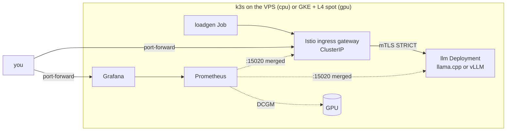

# llm-serving-lab

Serving an open source model on Kubernetes with a GPU, with **measured cost and
observability**. A small project built to be finished: it is done when a post on
allans.dev shows real p95, tokens/s and cost per thousand requests, and the
cluster is shut down.

**Budget cap:** US$50. **Timeline:** 3 to 4 weekends. Past 6 weeks, step 5 gets
cut (docs/decisions.md, D7).

## Scope

| In | Out |
|---|---|
| 1 cluster, 1 GPU node powered on only during tests | fine-tuning, RAG |
| 1 small model (Qwen2.5-1.5B-Instruct) on vLLM | multi-region |
| Istio as ingress, mTLS STRICT, per-route latency | advanced autoscaling |
| Prometheus + Grafana with cost per request and per token | front-end |

## Two profiles, same manifests

The Delfos VPS has no GPU. So everything is built there first, for free, and the
GPU is only turned on to take measurements (docs/decisions.md, D1).



| | `PROFILE=cpu` | `PROFILE=gpu` |
|---|---|---|
| Cluster | k3s, VPS srv1296923 (4 vCPU, 15 GB) | Zonal GKE, e2-standard-4 spot + g2-standard-4 spot (1× L4) |
| Server | llama.cpp, GGUF Q4_K_M | vLLM v0.32.0, bf16 |
| Cost/hour | ~US$0.014 (fixed) | ~US$0.35 (only while on) |
| kubeconfig | `.kube/cpu.yaml` (SSH tunnel) | `.kube/gpu.yaml` |

The Makefile **always** passes an explicit `--kubeconfig`, so it never uses the
machine's default context.

## Steps

- [ ] **1. GPU visible in the pod.** `make gke-up && make PROFILE=gpu gpu-operator gpu-check`
- [ ] **2. Model up.** `make deploy smoke`
- [ ] **3. Istio in front.** Gateway, VirtualService, `PeerAuthentication` STRICT, `AuthorizationPolicy` (`make istio`)
- [ ] **4. Metrics.** Per-route latency, req/s, tokens/s, GPU, CPU and memory (`make monitoring`)
- [ ] **5. Cost.** `llm:cost_usd_per_1k_requests` and `llm:cost_usd_per_1m_output_tokens` on the dashboard
- [ ] **6. Post.** `docs/post-template.md` filled in from `results/*.jsonl`
- [ ] **Done:** post published and `gcloud container clusters list` empty

## How to run

Local prerequisites: `kubectl`, `helm`, `kustomize`, `ansible-playbook`. For the
GPU profile: `gcloud` with `gke-gcloud-auth-plugin`.

### CPU profile (VPS)

```bash
make vps-check                 # playbook dry run (--check --diff)
make vps-up                    # k3s + firewall, saves .kube/cpu.yaml
make vps-tunnel                # in another terminal: ssh -L 6443
make platform                  # Istio + Prometheus/Grafana + rules + dashboard
make deploy smoke              # downloads the model (1 GB) and curls it through the gateway
make load                      # concurrency sweep 1,2,4,8 → results/cpu-*.jsonl
make grafana                   # http://localhost:3000, "LLM serving" dashboard
```

To undo: `make vps-down`. It removes only k3s and the firewall table; Delfos is
left untouched.

### GPU profile (GKE)

```bash
export GCP_PROJECT=my-project
infra/gke/budget.sh            # once: US$50 alert (needs BILLING_ACCOUNT)
make gke-up                    # cluster + L4 spot node, self-destructs after TTL=4h
make PROFILE=gpu gpu-operator gpu-check
make PROFILE=gpu platform deploy smoke load
make gke-down                  # don't forget, the TTL is only a safety net
```

Before running, check the spot price for your region in
`k8s/overlays/gpu/cost.yaml`. That value feeds the dashboard and `make load`.

## 24h dashboard at llm-lab.allans.dev

- `make probe`: a CronJob runs a short test (concurrency 1 and 4, 8 requests each) every hour at minute 7. Prometheus keeps 30 days on a persistent volume.
- `make edge`: creates the `llm-lab` Cloudflare tunnel and runs `cloudflared` **inside the cluster**. It opens no ports and does not use the Delfos tunnel.
- `CF_API_TOKEN=... make access`: creates the Cloudflare Access app (your email only), configures Grafana to accept the Access JWT and, last, creates the DNS record.
  Login is an email code only, with no Grafana password. Without a valid Access JWT, Grafana lets no one in, not even from inside the cluster.

## Layout

```
infra/vps/        k3s playbook (+ nftables firewall) and teardown
infra/gke/        up.sh / down.sh (with TTL) / budget.sh
platform/istio/   istiod and gateway values, Telemetry (path as a label)
platform/monitoring/  kube-prometheus-stack values, PodMonitor, llm:* rules, dashboard
platform/edge/    cloudflared for the llm-lab tunnel
platform/gpu/     NVIDIA GPU operator values + GKE ResourceQuota
k8s/base/         namespace, Service, Gateway, VirtualService, mTLS, AuthorizationPolicy
k8s/overlays/     cpu (llama.cpp) and gpu (vLLM), each with its own cost/hour
loadtest/         loadgen.py (stdlib) + Job
docs/             decisions and post draft
results/          load test output (.jsonl)
```

## What has been validated

On 2026-10-19, the whole CPU profile ran on a local kind cluster: Istio 1.30.6,
kube-prometheus-stack 92.10.1, llama.cpp b11723.
- `make smoke` answered through the gateway with mTLS STRICT.
- A direct call to the Service from outside the mesh was refused.
- Every `llm:*` series had values, including per-route latency and both costs.
- The dashboard imported on its own.
- `results/example-kind-laptop.jsonl` holds laptop numbers, only to show the
  format. Don't use them in the post.

Not yet run for real: the playbook on the VPS and the entire GPU profile (GKE,
GPU operator, vLLM, DCGM).
